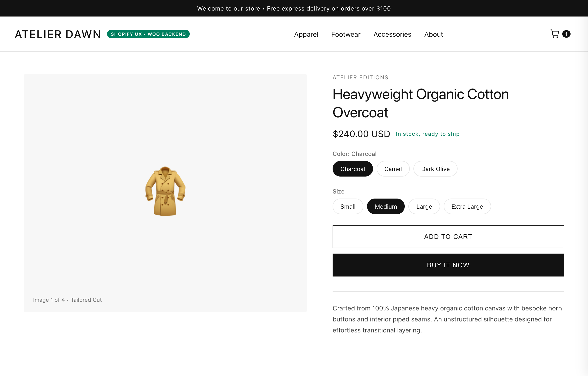
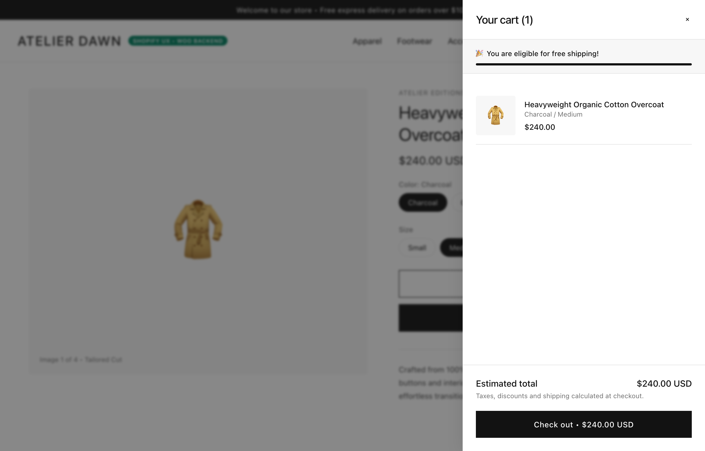

# 🛍️ DawnTwin · Shopify-Style WooCommerce Storefront Engine

[](https://github.com/harunsekmen/shopify-dawn-woocommerce-twin)
[](https://github.com/harunsekmen/shopify-dawn-woocommerce-twin/blob/main/LICENSE)
[](https://github.com/harunsekmen/shopify-dawn-woocommerce-twin)

> A clean reproduction of Shopify's modern Dawn theme user experience built natively on WooCommerce. Delivers a clean product page layout, swatch variant pills, and a slide-out cart drawer with complete data ownership.

Developed and maintained by **[Harun Sekmen](https://github.com/harunsekmen)** — E-Commerce Systems Engineer & WooCommerce Developer.

[✉️ Discuss Your Migration](mailto:sekmenwp@gmail.com) · [💼 Upwork Profile](https://www.upwork.com/freelancers/~01a7a8b58043e6e6d9) · [🔗 Main GitHub Profile](https://github.com/harunsekmen)

---

## 📸 Visual Previews & Storefront Demo

### 1. Minimalist Product Page
Clean typography, live stock availability, and intuitive variant selection matching modern e-commerce standards:



### 2. Slide-Out AJAX Drawer Cart
Shoppers can review their selections instantly with a built-in free shipping meter and fast checkout buttons:



---

## ⚡ The Problem It Solves

Many brand founders and e-commerce operators love the clean, minimalist look and fast user flow of Shopify's flagship **Dawn** theme. However, running a store on proprietary platforms often introduces real friction:
- **Recurring Monthly App Costs:** Essential store features—like slide-out cart drawers, currency selectors, and upsell modules—require monthly app subscriptions that add up quickly.
- **Platform Transaction Penalties:** Using your preferred payment gateway often comes with an additional percentage fee on every sale.
- **Platform Lock-In:** Customizing the checkout experience or integrating bespoke business workflows is restricted to enterprise tiers.

**DawnTwin** bridges this gap. It gives merchants the familiar, trusted shopping experience of a modern Shopify store while running on the flexible, self-hosted foundation of WooCommerce with High-Performance Order Storage (HPOS).

---

## 🛠️ Key Storefront Features

- **Shopify Dawn Aesthetic:** Minimalist layouts, clean 1px borders, subtle transitions, and responsive mobile-first grids.
- **Clickable Variant Pills:** Replaces dated select dropdowns with clean, clickable size, color, and option pills.
- **Slide-Out AJAX Drawer:** Instant cart feedback with live quantity updates and an automated shipping progress bar.
- **Direct Payment Gateways:** Connect directly to Stripe, PayPal, Apple Pay, Google Pay, or local processors with zero platform cuts.
- **High-Performance Order Storage (HPOS):** Built with native support for WooCommerce modern order tables and blocks.
- **Full Data Ownership:** Your customer records, order history, and product data remain completely under your control on your own server.

---

## 💼 Turnkey Store Builds & Shopify Migrations

Looking to migrate from Shopify to WooCommerce, or launch a new brand with a clean, modern shopping experience?

- **Catalog & Order Migration:** Clean transfer of products, variations, customer accounts, and historical order data.
- **Pixel-Perfect Storefront Setup:** Dawn-inspired design customized to your typography, photography, and brand palette.
- **Direct Gateway Configuration:** Stripe, PayPal, Apple Pay, and local merchant account integrations.
- **SEO & URL Preservation:** 301 redirects and URL mapping to protect your existing search engine rankings.

📩 **Get in touch:** Email **[sekmenwp@gmail.com](mailto:sekmenwp@gmail.com)** with your store URL or project scope, or hire me on **[Upwork](https://www.upwork.com/freelancers/~01a7a8b58043e6e6d9)**.

---

## 🚀 Developer Setup & Local Testing

1. **Clone the repository:**
   ```bash
   git clone https://github.com/harunsekmen/shopify-dawn-woocommerce-twin.git wp-content/plugins/shopify-dawn-woocommerce-twin
   ```

2. **Activate the plugin:**
   ```bash
   wp plugin activate shopify-dawn-woocommerce-twin
   ```

3. **Run local simulation tests:**
   ```bash
   node tests/run-e2e-test.js
   ```

---

## 📄 License

This open-source project is licensed under the **[GNU General Public License v3.0](LICENSE)**.

